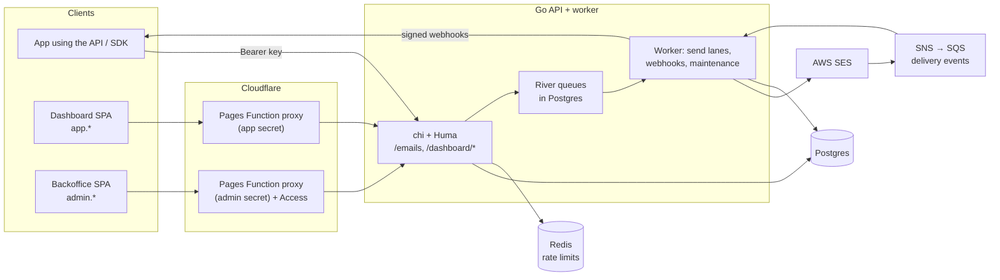

# mailmeow: showcase

mailmeow is a transactional email service I'm building: a **Resend-compatible API** on **AWS SES (Singapore)** with a **Thai-first dashboard** for people who aren't developers, such as small-business owners and people who build apps with AI tools.

The product code is private. This repo shows how it's built: the architecture, the decisions behind it, and a few hand-picked files from the real codebase. The excerpts are copied as they are, so they reference packages that aren't here and won't build on their own.

## What it does

- **Same API as Resend.** Existing code and the official `resend` package keep working by changing the base URL and key.
- **Plain-language dashboard.** "Is my email getting through?" first: a flow map from your app to the inbox, delivery and bounce rates against the line where sending pauses, and a three-step Get started that ends with a real test email.
- **Protects the sender's reputation.** Daily and monthly limits in the send path, automatic pause on bounce or spam-report spikes (with a warning at half the line), and blocked addresses after permanent bounces.
- **Teams.** Workspaces with owners, admins and members; invites; apps (projects) per workspace; API keys per app, live or test.
- **Webhooks** for delivery events, signed, retried, and guarded against internal-network requests (see `excerpts/go`).
- **A separate backoffice** for the team, on its own site, that the customer app never ships.

## Architecture

- **API and worker:** Go (chi + Huma v2 for typed, documented routes), pgx + sqlc, goose migrations, River for jobs (the queue lives in Postgres, so a send and its job commit in one transaction).
- **Dashboard and backoffice:** React 19, Vite, TanStack Router + Query, Tailwind 4. Two separate repos and sites; the API tells them apart by which proxy secret arrives and refuses admin routes to the customer site.
- **Sites:** Astro for the marketing site and the docs (Starlight), with `llms.txt` so AI assistants can read the docs.
- **Hosting:** Railway for the API and worker, Cloudflare Pages for the sites.

## Decisions worth a look

- **Limits that hold under concurrency.** The quota check runs inside the send under a row lock on the workspace, so 20 parallel sends at the edge of a limit can't all slip through. A test proves it fails without the lock.
- **Auto-pause on the same numbers the user sees.** The dashboard's meters draw the exact rates the pause rule judges (last 500 sends for bounces, a spam window for reports), not a friendlier 30-day number. That was a review finding I fixed.
- **One transaction for every admin action and its audit row.** If writing the audit row fails, the action rolls back. Resuming a paused sending lane locks the queue row first, so two admins can't both resume and log it twice.
- **Webhook URLs can't reach internal networks.** Checked when the URL is added and again at connect time, so a DNS answer that changes later doesn't get through (`excerpts/go`).
- **Thai is a first-class language, not a translation.** Thai line heights in the tokens, phrases joined with spaces instead of English commas, and a written rule for tech terms: everyday nouns stay Thai (แอป, โดเมน), technical terms stay English (API key, Webhook), based on how large Thai products write their UI.
- **Simple by default, advanced when asked.** Every flow asks only what the common case needs and folds the rest under "Advanced settings" with the defaults shown in one line.

## How it's built

I work with AI coding agents in fixed roles: a planner and reviewer on a strong model, builders that implement an already-specified task, a cheap scout that only watches for stuck work (`excerpts/tooling/stuck-watch.sh`), and an independent reviewer after each batch. A builder's report is never trusted on its own: I read the actual diff, run the checks, and try the change in a browser before accepting it.

## Excerpts

| File | What it shows |
|---|---|
| `excerpts/go/netguard.go` | Blocking webhook requests to internal networks: blocked ranges (including IPv6 forms that wrap IPv4), a check when the URL is added, and a dialer hook checked at connect time |
| `excerpts/go/netguard_test.go` | Table tests for the guard, including rebinding and IPv4-in-IPv6 cases |
| `excerpts/react/flow-map.tsx` | The dashboard's "where does my email go" map: one node per step with its state, readable by screen readers, joining Thai phrases with spaces |
| `excerpts/design/tokens.css` | The design system as tokens: light and dark, status colours, Thai-specific line heights, one spacing and sizing standard |
| `excerpts/tooling/stuck-watch.sh` | The scout's read-only watch for stuck builders and hung tests |

## Licence

Copyright (c) 2026 [stateless-x](https://github.com/stateless-x). All rights reserved. Shared for reading only; no licence to use, copy or modify the code is granted.
